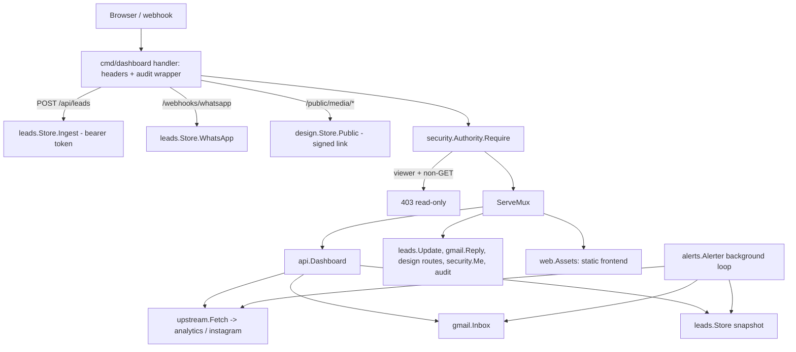

# Architecture

One Go module (`arecosys-dashboard`) that serves an embedded vanilla JS dashboard and a small JSON API.

## Layers

| Layer | Folder | Responsibility |
|---|---|---|
| entry | `cmd/dashboard` | `main`: env wiring, middleware chain, routes, server start |
| api | `internal/api` | Handlers that combine several services into one response |
| services | `internal/services/{leads,design,alerts}` | Lead store and intake, design library and Instagram post queue, alerts and weekly report |
| adapters | `internal/adapters/{gmail,instagram,analytics,upstream}` | External API clients (Gmail, Instagram Graph, GA4, upstream JSON feeds) |
| security | `internal/security` | Sign-in, roles, rate limiting, audit log, password hashing |
| domain | `internal/domain` | `Lead`, `Activity`, `Source` |
| platform | `internal/platform/httpx` | Shared HTTP client, JSON request and response helpers |
| frontend | `web` | HTML, CSS and JS, embedded into the binary (`web/embed.go`) |
| docs | `docs` | This file and sample content (`docs/samples`) |

Dependencies point downward: `cmd` -> `api` -> `services` -> `adapters` -> `platform` / `domain`, with `security` usable from services and adapters. No package imports a layer above it.

## Request flow

## Where new code goes

- New external API client: `internal/adapters/<name>`.
- New business rule or stored data: `internal/services/<name>`.
- New response that merges services: `internal/api`.
- New entity shared by packages: `internal/domain`.
- New env-driven wiring or route: `cmd/dashboard/main.go`.
- Frontend changes: `web/` (add new files to the `//go:embed` line in `web/embed.go`).

## Known split candidates

Some HTTP handlers still live on their service types (`leads.Store.Ingest/Update/WhatsApp`, `design.Store` routes) and `gmail.Reply` sits in the gmail adapter. They were kept in place so the restructure changed no behavior; moving them into `internal/api` is a possible follow-up.
